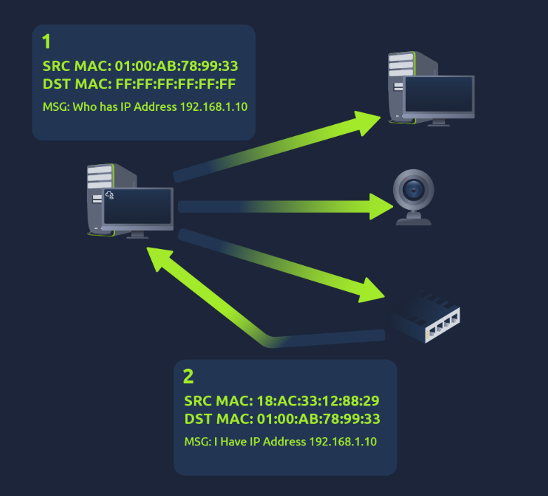

[<-- Back to Network Menu](../network/00-MENU.md)

# 📌 ARP (Address Resolution Protocol)

> Giao thức dùng để ánh xạ địa chỉ IP thành địa chỉ MAC, giúp các thiết bị xác định đúng thiết bị đích trong cùng một mạng.

---

## 📖 Khái niệm

Mỗi thiết bị trên mạng đều có hai định danh:

- **IP Address**: Định danh logic dùng để giao tiếp trên mạng.
- **MAC Address**: Định danh vật lý của card mạng.

**ARP (Address Resolution Protocol)** là giao thức cho phép liên kết (map) **IP Address** với **MAC Address**.

Mỗi thiết bị sẽ lưu thông tin ánh xạ IP ↔ MAC của các thiết bị khác trong một bảng gọi là **ARP Cache**.

Khi cần giao tiếp với một thiết bị khác nhưng chưa biết MAC Address của thiết bị đó, ARP sẽ được sử dụng để tìm kiếm.

---

## ⚙️ Cách hoạt động

### Luồng hoạt động

<p align="center">
  
  <br>
  <i>ARP Diagram</i>
</p>

---

### Quá trình

#### 1. ARP Request

Thiết bị gửi một **Broadcast** đến toàn bộ mạng để hỏi:

> "Thiết bị nào sở hữu IP Address này?"

Ví dụ:

```text
Destination MAC

FF:FF:FF:FF:FF:FF
(Broadcast)
```

Thông điệp:

```text
Who has
192.168.1.10 ?
```

---

#### 2. ARP Reply

Chỉ thiết bị sở hữu IP Address đó mới phản hồi.

Thông điệp:

```text
I have
192.168.1.10

MAC:
18:AC:33:12:88:29
```

---

#### 3. Lưu vào ARP Cache

Sau khi nhận được phản hồi, thiết bị gửi sẽ lưu cặp:

```text
192.168.1.10
↓

18:AC:33:12:88:29
```

vào **ARP Cache** để sử dụng cho các lần giao tiếp sau mà không cần gửi Broadcast lại.

---

## 📝 Ghi nhớ

- ARP dùng để **tìm MAC Address từ IP Address**.
- ARP chỉ hoạt động trong **mạng cục bộ (LAN)**.
- ARP sử dụng hai loại thông điệp:
  - ARP Request
  - ARP Reply
- ARP Request được gửi theo dạng **Broadcast**.
- Thiết bị nhận sẽ lưu kết quả vào **ARP Cache** để giảm số lần Broadcast.

---

## 🔗 Liên quan

- IP Address
- MAC Address
- ARP Cache
- Broadcast
- LAN

---

## 📚 Nguồn tham khảo

- [TryHackMe - ARP](https://tryhackme.com/room/introtolan)

[<-- Back to Network Menu](../network/00-MENU.md)