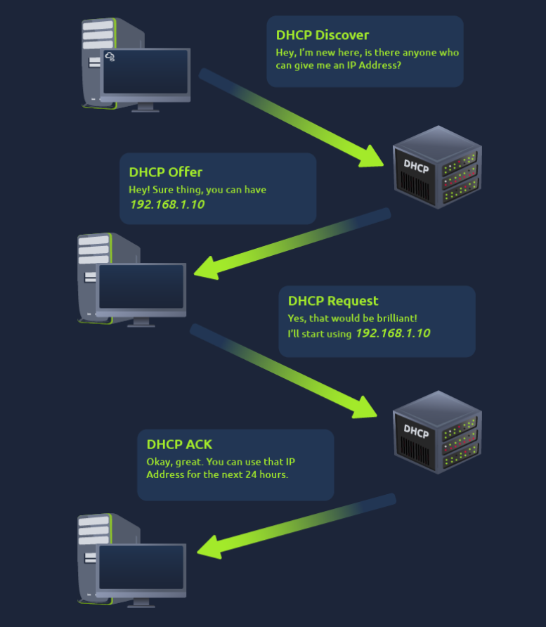

[<-- Back to Network Menu](../network/00-MENU.md)

# 📌 DHCP (Dynamic Host Configuration Protocol)

> Giao thức tự động cấp phát địa chỉ IP và các thông số mạng cho thiết bị khi tham gia vào mạng.

---

## 📖 Khái niệm

DHCP (Dynamic Host Configuration Protocol) là giao thức dùng để **tự động cấp phát địa chỉ IP** cho các thiết bị trong mạng.

Thay vì người quản trị phải cấu hình IP thủ công cho từng thiết bị, DHCP Server sẽ tự động gán một địa chỉ IP khả dụng khi thiết bị kết nối vào mạng.

Nếu thiết bị chưa được cấu hình IP tĩnh, nó sẽ gửi yêu cầu đến DHCP Server để xin cấp phát địa chỉ IP.

---

### Quy trình DORA

<p align="center">
  
  <br>
  <i>DHCP</i>
</p>

#### 1. DHCP Discover

Thiết bị vừa kết nối vào mạng sẽ tìm DHCP Server.

```text
Client
   │
   │ DHCP Discover
   ▼
DHCP Server

"Is there anyone who can
give me an IP Address?"
```

---

#### 2. DHCP Offer

DHCP Server phản hồi bằng một địa chỉ IP có thể sử dụng.

```text
DHCP Server
      │
      │ DHCP Offer
      ▼
Client

"You can use

192.168.1.10"
```

---

#### 3. DHCP Request

Thiết bị xác nhận muốn sử dụng địa chỉ IP được đề xuất.

```text
Client
    │
    │ DHCP Request
    ▼
DHCP Server

"I'll use

192.168.1.10"
```

---

#### 4. DHCP ACK

DHCP Server xác nhận việc cấp phát đã hoàn tất.

```text
DHCP Server
      │
      │ DHCP ACK
      ▼
Client

"You may use this IP
for the next 24 hours."
```

Sau khi nhận ACK, thiết bị có thể bắt đầu sử dụng địa chỉ IP được cấp để giao tiếp trên mạng.

---

## 📝 Ghi nhớ

- DHCP giúp tự động cấp phát địa chỉ IP.
- DHCP Server thay thế việc cấu hình IP thủ công.
- Quy trình cấp phát IP gồm 4 bước:
  - Discover
  - Offer
  - Request
  - ACK (DORA)
- Sau khi nhận DHCP ACK, thiết bị có thể sử dụng địa chỉ IP được cấp.

---

## 🔗 Liên quan

- IP Address
- Subnetting
- Default Gateway
- ARP
- Router

---

## 📚 Nguồn tham khảo

- [TryHackMe - DHCP](https://tryhackme.com/room/introtolan)

[<-- Back to Network Menu](../network/00-MENU.md)