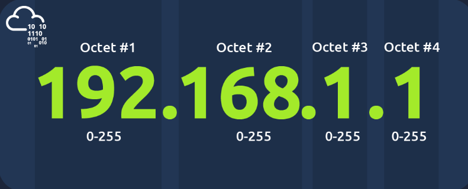
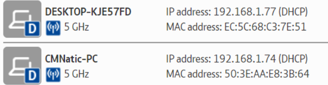
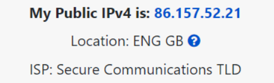
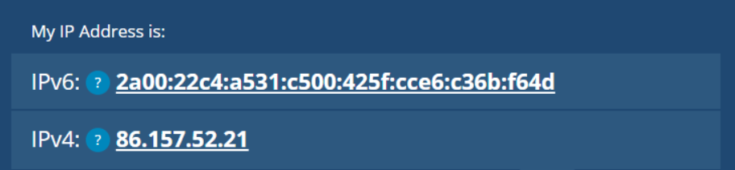
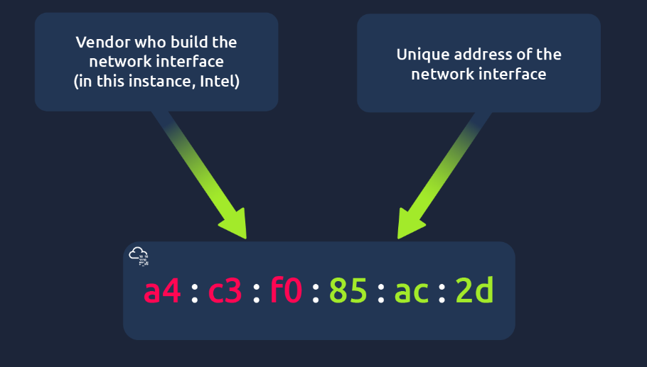

[<-- Back to Network Menu](../network/00-MENU.md)

# 📌 IP Address & MAC Address

> Hai cơ chế định danh thiết bị trên mạng: IP Address xác định vị trí giao tiếp, còn MAC Address định danh phần cứng của thiết bị.

---

## 📖 Khái niệm

Để các thiết bị có thể giao tiếp và duy trì trật tự trên mạng, mỗi thiết bị cần có khả năng **định danh** và **được định danh**.

Tương tự con người có:
- Tên
- Dấu vân tay

Thiết bị mạng cũng có hai cách nhận diện:

- **IP Address**: Có thể thay đổi theo thời gian, dùng để xác định thiết bị trên mạng.
- **MAC Address**: Được gán cho card mạng từ khi sản xuất, tương tự số serial của thiết bị.

---

## ⚙️ Cách hoạt động

### 1. IP Address

IP Address (Internet Protocol Address) là địa chỉ dùng để xác định một thiết bị trên mạng trong một khoảng thời gian.

Đặc điểm:

- Gồm **4 Octet**.
- Mỗi Octet có giá trị từ **0–255**.

<p align="center">
  
  <br>
  <i>IP Address</i>
</p>

Lưu ý:

- Một IP không thể được sử dụng đồng thời bởi nhiều thiết bị trong cùng một mạng.
- IP hoạt động theo các giao thức Internet Protocol.

---

### 2. Public IP và Private IP

Internet được tạo thành từ nhiều mạng riêng.

<p align="center">
  
  <br>
  <i>Devices</i>
</p>

**Private IP**

- Dùng để nhận diện thiết bị trong mạng nội bộ.
- Các thiết bị trong cùng mạng sử dụng Private IP để giao tiếp với nhau.

```text
192.168.1.74
192.168.1.77
```

**Public IP**

- Dùng để nhận diện mạng trên Internet.
- Được cấp bởi ISP (Internet Service Provider).
- Các thiết bị trong cùng mạng có thể cùng sử dụng một Public IP khi truy cập Internet.

<p align="center">
  
  <br>
  <i>Public IP</i>
</p>

---

### 3. IPv4 và IPv6

<p align="center">
  
  <br>
  <i>IPV4 & IPV6</i>
</p>

Do số lượng thiết bị kết nối Internet ngày càng tăng, IPv4 dần không còn đủ địa chỉ.

**IPv4**

- Khoảng **2³²** địa chỉ (~4,29 tỷ địa chỉ).

**IPv6**

- Hỗ trợ tới **2¹²⁸** địa chỉ.
- Được thiết kế để giải quyết tình trạng thiếu địa chỉ IPv4.
- Áp dụng phương pháp định địa chỉ hiệu quả hơn.

---

### 4. MAC Address

MAC (Media Access Control) Address là địa chỉ vật lý của card mạng.

<p align="center">
  
  <br>
  <i>MAC Addess</i>
</p>

- Được nhà sản xuất gán khi thiết bị được tạo ra.
- Gồm **12 ký tự hệ thập lục phân (Hexadecimal)**.
- Chia thành hai phần:
  - 6 ký tự đầu: Nhà sản xuất card mạng.
  - 6 ký tự cuối: Định danh duy nhất của card mạng.

MAC Address có thể bị giả mạo (**MAC Spoofing**) để thiết bị mạo danh một thiết bị khác trên mạng.

---

## 📝 Ghi nhớ

- Thiết bị được nhận diện bằng **IP Address** và **MAC Address**.
- IP Address có thể thay đổi, MAC Address gắn với card mạng.
- Private IP dùng trong mạng nội bộ, Public IP dùng trên Internet.
- IPv6 được tạo ra để khắc phục giới hạn địa chỉ của IPv4.
- MAC Address có thể bị giả mạo bằng kỹ thuật **MAC Spoofing**.

---

## 🔗 Liên quan

- Network
- Internet
- IPv4
- IPv6
- MAC Spoofing
- ISP
- Subnetting

---

## 📚 Nguồn tham khảo

- [TryHackMe - IP Address & MAC Adderss](https://tryhackme.com/room/whatisnetworking)

[<-- Back to Network Menu](../network/00-MENU.md)