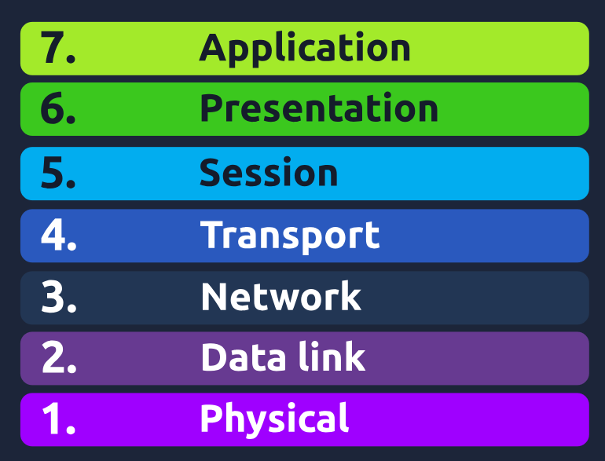

[<-- Back to OSI Menu](../osi-model.md)

# 📌 OSI Model

> Mô hình tham chiếu gồm 7 tầng mô tả cách dữ liệu được truyền và xử lý giữa các thiết bị trong mạng.

---

## 📖 Khái niệm

OSI (Open Systems Interconnection) là mô hình tham chiếu được sử dụng để mô tả cách các thiết bị giao tiếp với nhau qua mạng.

Thay vì coi việc truyền dữ liệu là một quá trình duy nhất, OSI chia quá trình này thành **7 tầng (Layer)**. Mỗi tầng đảm nhận một nhiệm vụ riêng và phối hợp với các tầng còn lại để dữ liệu được truyền từ thiết bị nguồn đến thiết bị đích.

Việc chia thành nhiều tầng giúp các thiết bị có thể giao tiếp với nhau ngay cả khi chúng được sản xuất bởi các hãng khác nhau, miễn là cùng tuân theo mô hình OSI.

---

## ⚙️ Cách hoạt động

OSI Model gồm 7 tầng:

  
   
  <i>OSI Model</i>

## 📖 Chức năng của từng tầng

| Layer | Tên | Chức năng |
|------|----------------|--------------------------------------------|
| 7 | Application | Cung cấp dịch vụ mạng cho các ứng dụng. |
| 6 | Presentation | Chuyển đổi, chuẩn hóa và mã hóa dữ liệu. |
| 5 | Session | Thiết lập, duy trì và kết thúc phiên làm việc. |
| 4 | Transport | Đảm bảo dữ liệu được truyền giữa hai thiết bị. |
| 3 | Network | Định tuyến dữ liệu bằng địa chỉ IP. |
| 2 | Data Link | Sử dụng địa chỉ MAC để truyền dữ liệu trong mạng cục bộ. |
| 1 | Physical | Truyền dữ liệu dưới dạng tín hiệu vật lý. |

* Mỗi tầng sẽ bổ sung hoặc xử lý một phần thông tin trước khi chuyển dữ liệu xuống tầng tiếp theo.

* Quá trình thêm thông tin vào dữ liệu khi đi từ Layer 7 xuống Layer 1 được gọi là **Encapsulation**.

---

## 📝 Ghi nhớ

- OSI là mô hình gồm **7 tầng**.
- Mỗi tầng đảm nhiệm một chức năng riêng.
- Dữ liệu phải đi qua tất cả các tầng để được truyền trên mạng.
- Quá trình bổ sung thông tin khi dữ liệu đi xuống các tầng gọi là **Encapsulation**.
- OSI là nền tảng giúp hiểu cách các giao thức mạng hoạt động.

---

## 🔗 Liên quan

- Physical Layer
- Data Link Layer
- Network Layer
- TCP/IP Model
- Encapsulation

---

## 📚 Nguồn tham khảo

- [TryHackMe - OSI Model](https://tryhackme.com/room/osimodelzi)

[<-- Back to OSI Menu](../osi-model.md)