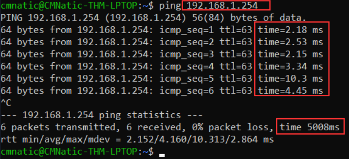

[<-- Back to Network Menu](../network/00-MENU.md)

# 📌 Ping

> Công cụ mạng cơ bản dùng giao thức ICMP để kiểm tra khả năng kết nối và đo thời gian phản hồi giữa hai thiết bị.

---

## 📖 Khái niệm

**Ping** là một trong những công cụ mạng cơ bản và phổ biến nhất.

Ping sử dụng các gói tin **ICMP (Internet Control Message Protocol)** để kiểm tra:

- Thiết bị đích có thể truy cập được hay không.
- Kết nối có hoạt động ổn định hay không.
- Thời gian phản hồi (Latency) giữa hai thiết bị.

Ping có thể được sử dụng để kiểm tra các thiết bị trong mạng nội bộ hoặc các tài nguyên trên Internet như website, máy chủ,...

---

## ⚙️ Cách hoạt động

### Luồng hoạt động

```text
Thiết bị A
     │
     │ ICMP Echo Request
     ▼
Thiết bị B
     │
     │ ICMP Echo Reply
     ▼
Thiết bị A
```

Quá trình:

1. Thiết bị nguồn gửi **ICMP Echo Request**.
2. Thiết bị đích nhận được yêu cầu.
3. Thiết bị đích phản hồi bằng **ICMP Echo Reply**.
4. Ping đo thời gian từ lúc gửi đến khi nhận phản hồi (Round Trip Time - RTT).

---

### Kết quả trả về

<p align="center">
  
  <br>
  <i>Ping</i>
</p>

Các thông tin quan trọng:

| Thành phần | Ý nghĩa |
|------------|----------|
| `icmp_seq` | Thứ tự của gói ICMP được gửi |
| `ttl` | Time To Live của gói tin |
| `time` | Thời gian phản hồi giữa hai thiết bị |

Sau khi kết thúc, Ping sẽ thống kê:

- Số gói đã gửi.
- Số gói nhận được.
- Tỷ lệ mất gói (Packet Loss).
- Thời gian phản hồi trung bình.

---

## 📝 Ghi nhớ

- Ping sử dụng giao thức **ICMP**.
- Ping dùng để kiểm tra khả năng kết nối giữa hai thiết bị.
- Ping đo thời gian phản hồi (Latency/RTT).
- Có thể Ping bằng **địa chỉ IP** hoặc **tên miền (Website)**.
- Kết quả Ping cho biết số gói gửi, số gói nhận, tỷ lệ mất gói và thời gian phản hồi.

---

## 🔗 Liên quan

- ICMP
- IP Address
- Packet
- TTL
- Traceroute

---

## 📚 Nguồn tham khảo

- [TryHackMe - Ping](https://tryhackme.com/room/whatisnetworking)

[<-- Back to Network Menu](../network/00-MENU.md)