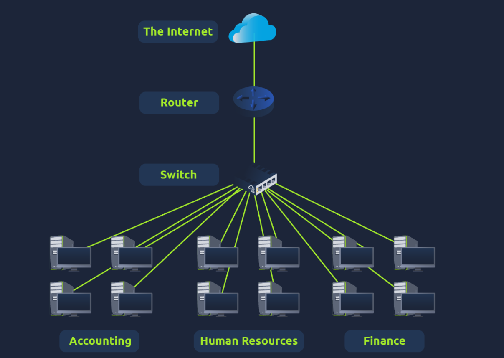
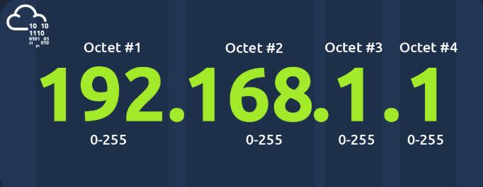

[<-- Back to Network Menu](../network/00-MENU.md)

# 📌 Subnetting

> Kỹ thuật chia một mạng lớn thành nhiều mạng nhỏ (Subnet) để quản lý, tăng hiệu quả và nâng cao bảo mật.

---

## 📖 Khái niệm

Subnetting là quá trình chia một mạng lớn thành nhiều mạng nhỏ hơn (**Subnet**).

Có thể hình dung Subnetting giống như việc chia một chiếc bánh thành nhiều phần cho các nhóm khác nhau. Trong mạng máy tính, mỗi subnet đại diện cho một nhóm thiết bị hoặc một bộ phận riêng biệt.

Ví dụ trong một doanh nghiệp:

- Accounting
- Human Resources
- Finance

Mỗi phòng ban có thể được đặt trong một subnet riêng để dễ quản lý và kiểm soát lưu lượng mạng.

Việc chia mạng được thực hiện bằng **Subnet Mask**, giúp xác định phạm vi của từng subnet.

---

## ⚙️ Cách hoạt động

  
   
  <i>Subneting</i>

Mỗi phòng ban được tách thành một subnet riêng nhưng vẫn có thể kết nối ra Internet thông qua Router.

---

### Subnet Mask

Địa chỉ IP gồm **4 Octet**.

  
   
  <i>Subneting IP</i>

Subnet Mask cũng gồm **4 Byte (32 bit)** và được dùng để chia mạng thành các subnet.

---

### Thành phần của một Subnet

| Type | Purpose | Explanation | Example |
| :--- | :--- | :--- | :--- |
| **Network Address** | Địa chỉ này xác định điểm bắt đầu của mạng thực tế và được dùng để nhận diện sự tồn tại của một mạng | Ví dụ, một thiết bị có địa chỉ IP là 192.168.1.100 sẽ nằm trên mạng được xác định bởi 192.168.1.0 | 192.168.1.0 |
| **Host Address** | Tại đây, địa chỉ IP được sử dụng để xác định một thiết bị trên mạng con | Ví dụ, một thiết bị sẽ có địa chỉ mạng là 192.168.1.1 | 192.168.1.100 |
| **Default Gateway** | Địa chỉ cổng mặc định (default gateway) là một địa chỉ đặc biệt được gán cho một thiết bị trên mạng, có khả năng gửi thông tin đến một mạng khác | Mọi dữ liệu cần được gửi đến một thiết bị không nằm trong cùng mạng (ví dụ: không thuộc dải 192.168.1.0) sẽ được chuyển đến thiết bị này. Các thiết bị này có thể sử dụng bất kỳ địa chỉ host nào, nhưng thông thường chúng sẽ dùng địa chỉ host đầu tiên hoặc cuối cùng trong mạng (là .1 hoặc .254) | 192.168.1.254 |

---

## 📝 Ghi nhớ

- Subnetting là kỹ thuật chia mạng lớn thành nhiều subnet nhỏ.
- Việc chia subnet được thực hiện bằng Subnet Mask.
- Mỗi subnet gồm:
  - Network Address
  - Host Address
  - Default Gateway
- Subnetting mang lại các lợi ích:
  - Tăng hiệu quả.
  - Tăng bảo mật.
  - Kiểm soát mạng tốt hơn.
- Các tổ chức lớn thường sử dụng nhiều subnet để tách các phòng ban hoặc nhóm thiết bị.

---

## 🔗 Liên quan

- IP Address
- Subnet Mask
- Default Gateway
- Router
- Switch
- LAN

---

## 📚 Nguồn tham khảo

- [TryHackMe - Subnetting](https://tryhackme.com/room/introtolan)

[<-- Back to Network Menu](../network/00-MENU.md)