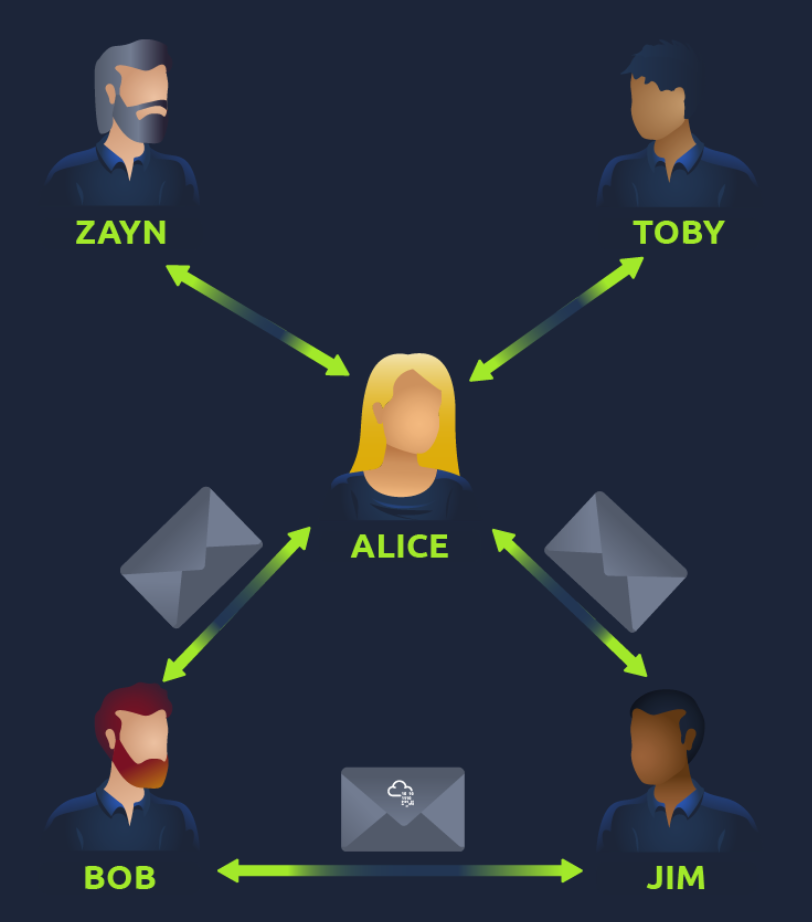
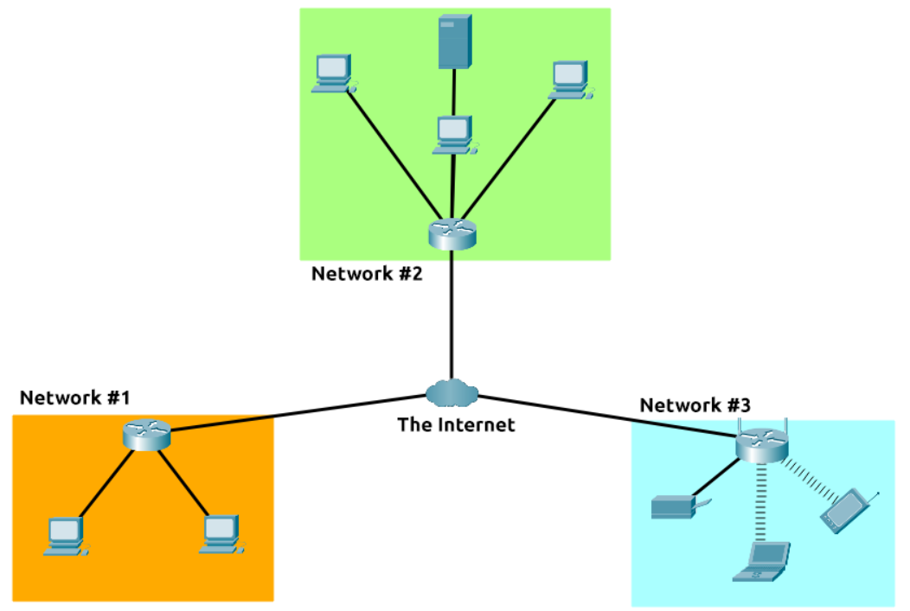

[<-- Back to Network Menu](../network/00-MENU.md)

# 📌 What is Internet?

> Một mạng lưới khổng lồ được tạo thành từ rất nhiều mạng nhỏ kết nối với nhau.

---

## 📖 Khái niệm

Internet là một mạng rất lớn, được tạo thành từ vô số mạng nhỏ kết nối với nhau.

Có thể hình dung Internet giống như việc nhiều nhóm bạn được kết nối thông qua một người có thể giao tiếp với tất cả các nhóm. Trong ví dụ của bài học, Alice có thể nói được ngôn ngữ của cả hai nhóm nên trở thành cầu nối giúp mọi người giao tiếp với nhau, từ đó hình thành một mạng lớn hơn.

Phiên bản đầu tiên của Internet xuất hiện từ dự án **ARPANET** vào cuối những năm 1960. Đến năm **1989**, **Tim Berners-Lee** tạo ra **World Wide Web (WWW)**, giúp Internet trở thành nơi lưu trữ và chia sẻ thông tin như ngày nay.

Internet bao gồm:

- Nhiều **Private Network (Mạng riêng)**.
- Được kết nối với nhau thông qua **Public Network (Internet)**.

---

## ⚙️ Cách hoạt động

  
   
  <i>Alice Bob Jim Zayn Toby</i>

Alice đóng vai trò trung gian giúp các nhóm có thể giao tiếp với nhau.

### Kiến trúc Internet

  
   
  <i>Internet Diagram</i>

Luồng hoạt động:

1. Mỗi tổ chức hoặc khu vực xây dựng một mạng riêng (Private Network).
2. Các mạng riêng kết nối vào Internet.
3. Internet trở thành cầu nối giúp các mạng này giao tiếp với nhau.
4. Thiết bị trên mạng sử dụng các nhãn (labels) để nhận diện lẫn nhau.

---

## 📝 Ghi nhớ

- Internet là tập hợp của rất nhiều mạng nhỏ.
- Các mạng nhỏ được gọi là **Private Network**.
- Internet đóng vai trò là **Public Network** kết nối các mạng riêng.
- ARPANET là nền tảng đầu tiên của Internet.
- World Wide Web (WWW) giúp Internet trở thành kho lưu trữ và chia sẻ thông tin.

---

## 🔗 Liên quan

- Network
- Private Network
- Public Network
- IP Address
- World Wide Web (WWW)

---

## 📚 Nguồn tham khảo

- [TryHackMe - What is Internet?](https://tryhackme.com/room/whatisnetworking)

[<-- Back to Network Menu](../network/00-MENU.md)