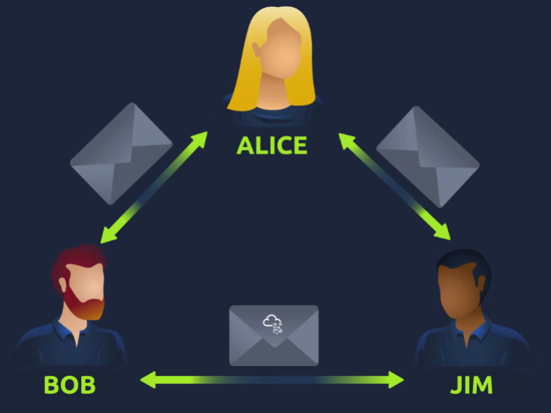

[<-- Back to Network Menu](../network/00-MENU.md)

# 📌 What is Networking?

> Hiểu khái niệm Network (mạng), cách các thiết bị kết nối với nhau để chia sẻ thông tin, tài nguyên và giao tiếp trong thế giới số.

---

## 📖 Khái niệm

### 1. What Is a Network?

**Network (Mạng)** là tập hợp các đối tượng được kết nối với nhau.

Trong cuộc sống, mạng có thể tồn tại dưới nhiều hình thức khác nhau. Các đối tượng kết nối nhờ những điểm chung, mục đích hoặc nhu cầu trao đổi.

Ví dụ:
- **Friendship Network:** Nhóm bạn kết nối với nhau thông qua sở thích, kỹ năng hoặc các hoạt động chung.
- **Transportation Network:** Hệ thống giao thông kết nối các địa điểm trong thành phố.
- **Power Grid:** Mạng lưới điện cung cấp điện đến các hộ gia đình và cơ sở.
- **Postal Network:** Hệ thống bưu chính kết nối người gửi và người nhận thư, bưu phẩm.

Ý tưởng chung của Network là các thành phần được kết nối với nhau để trao đổi hoặc hỗ trợ một mục đích nào đó.

### 2. Computer Network

Trong lĩnh vực Computing, Network cũng có cùng ý tưởng, nhưng các thành phần được kết nối là những thiết bị công nghệ.

**Computer Network (Mạng máy tính)** là hệ thống gồm các thiết bị được kết nối với nhau nhằm giao tiếp, trao đổi dữ liệu và truy cập tài nguyên.

Các thiết bị trong mạng có thể bao gồm:

- Laptop và Desktop.
- Smartphone và Tablet.
- Server.
- Security Cameras.
- Traffic Lights.
- Smart Devices.
- Các thiết bị trong hệ thống nông nghiệp thông minh.

Một Network có thể chỉ gồm 2 thiết bị hoặc mở rộng đến hàng tỷ thiết bị.

---

## ⚙️ Cách hoạt động

### Network Connection Concept

Một mạng được hình thành khi các thiết bị có kết nối với nhau.

Ví dụ, Alice, Bob và Jim tạo thành một mạng khi họ được kết nối và có thể giao tiếp với nhau.

  
   
  <i>Alice Bob Jim</i>

Trong sơ đồ trên:

- Alice, Bob và Jim là các thành phần trong mạng.
- Các đường nối thể hiện kết nối giữa các thành phần.
- Mạng cho phép các thành phần kết nối với nhau.

Trong Computer Networking, các thành phần tương tự có thể là máy tính, điện thoại, server hoặc những thiết bị mạng khác.

---

## 📝 Ghi nhớ

- Network là các thành phần được kết nối với nhau.
- Network tồn tại trong nhiều lĩnh vực, không chỉ trong máy tính.
- Computer Network kết nối các thiết bị công nghệ để giao tiếp và truy cập tài nguyên.
- Một Network có thể gồm 2 thiết bị hoặc hàng tỷ thiết bị.
- Laptop, smartphone, camera, traffic lights và smart farming devices đều có thể tham gia Network.
- Networks được tích hợp sâu vào đời sống hiện đại.
- Networking là kiến thức nền tảng cần thiết để học Cyber Security.
- Thiết bị trong mạng giao tiếp với nhau theo các quy tắc nhất định.

---

## 🔗 Liên quan

- Computer Networking
- Internet Fundamentals
- Network Devices
- Network Protocols
- Data Communication
- Network Security
- Cyber Security Fundamentals

---

## 📚 Nguồn tham khảo

* [TryHackMe – What is Networking?](https://tryhackme.com/room/whatisnetworking)

[<-- Back to Network Menu](../network/00-MENU.md)