[<-- Back to Operating System Menu](../operating-system/00-MENU.md)

# 📌 Linux CLI Basic – Giao diện dòng lệnh Linux cơ bản 

> Terminal Linux cho phép người dùng điều khiển hệ thống bằng dòng lệnh, tìm kiếm tệp tin, điều hướng hệ thống tệp và thu thập thông tin phục vụ công việc quản trị, giám sát và an ninh mạng.

---

## 📖 Khái niệm

### 1. Terminal Linux

Terminal là giao diện dòng lệnh cho phép người dùng nhập lệnh để tương tác với hệ điều hành thay vì thao tác thông qua giao diện đồ họa.

Trong lĩnh vực an ninh mạng, Terminal thường được sử dụng để:

- Quản trị máy chủ và kiểm tra cấu hình.
- Thu thập thông tin hệ thống.
- Tìm kiếm, đọc và phân tích tệp nhật ký.
- Chạy các công cụ kiểm thử bảo mật và điều tra sự cố.

### 2. Hệ thống tệp Linux

Linux tổ chức dữ liệu theo cấu trúc cây thư mục, bắt đầu từ thư mục gốc `/`.

Một số đường dẫn quan trọng:

- `/`: Thư mục gốc của hệ thống.
- `/home`: Chứa thư mục cá nhân của người dùng thông thường.
- `/etc`: Chứa phần lớn các tệp cấu hình hệ thống.
- `/var/log`: Thường chứa nhật ký hệ thống và ứng dụng.
- `~`: Ký hiệu đại diện cho thư mục cá nhân của người dùng hiện tại.
- `.`: Đại diện cho thư mục hiện tại.
- `..`: Đại diện cho thư mục cha.

### 3. Các lệnh cơ bản

| Lệnh | Chức năng |
|---|---|
| `pwd` | Hiển thị đường dẫn thư mục hiện tại. |
| `ls` | Liệt kê tệp tin và thư mục. |
| `ls -l` | Liệt kê chi tiết quyền truy cập, chủ sở hữu, kích thước và thời gian sửa đổi. |
| `ls -al` | Liệt kê chi tiết cả các mục ẩn. |
| `cd` | Di chuyển giữa các thư mục. |
| `find` | Tìm kiếm tệp tin và thư mục theo điều kiện. |
| `cat` | Hiển thị nội dung tệp tin văn bản. |
| `whoami` | Hiển thị tên tài khoản đang thực thi lệnh. |
| `uname -a` | Hiển thị thông tin kernel và kiến trúc hệ thống. |
| `df -h` | Hiển thị dung lượng các hệ thống tệp theo định dạng dễ đọc. |

### 4. Một số thuật ngữ cần phân biệt

- **Kernel:** Thành phần cốt lõi quản lý tài nguyên phần cứng, tiến trình, bộ nhớ và các hoạt động của hệ điều hành.
- **Distribution (bản phân phối):** Hệ điều hành Linux hoàn chỉnh được xây dựng từ kernel cùng các công cụ, thư viện và phần mềm khác, ví dụ Ubuntu hoặc Debian.
- **Filesystem:** Cách tổ chức và quản lý dữ liệu trên thiết bị lưu trữ hoặc vùng lưu trữ logic.
- **Hidden file (tệp ẩn):** Trong cách hiển thị thông thường của Linux, tên tệp bắt đầu bằng dấu chấm `.` sẽ không xuất hiện khi chạy `ls` mà không có tùy chọn phù hợp.

---

## ⚙️ Cách hoạt động

### 1. Điều hướng và tìm kiếm tệp tin

#### Bước 1: Xác định vị trí hiện tại

  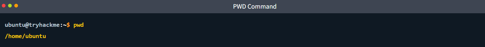
   
  <i>pwd</i>

Điều này cho biết phiên làm việc hiện tại đang ở thư mục `/home/ubuntu`.

#### Bước 2: Liệt kê nội dung thư mục

- `ls`: Hiển thị các tệp tin và thư mục thông thường.
- `ls -l`: Hiển thị thông tin chi tiết.
- `ls -al`: Hiển thị thông tin chi tiết, bao gồm cả các mục ẩn.

<table align="center">
  <tr>
    <td align="center">
      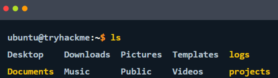
       
      <i>ls</i>
    </td>
    <td align="center">
      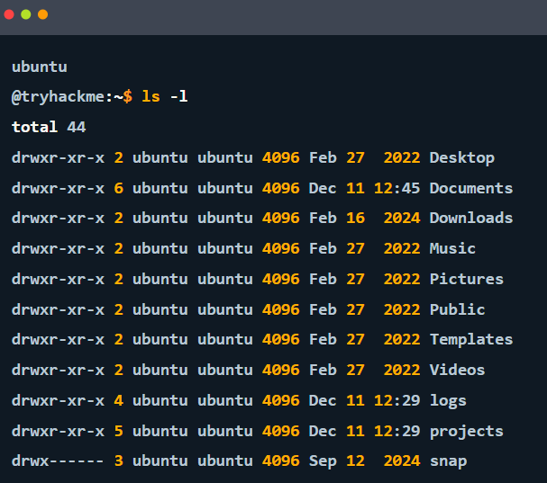
       
      <i>ls -l</i>
    </td>
    <td align="center">
      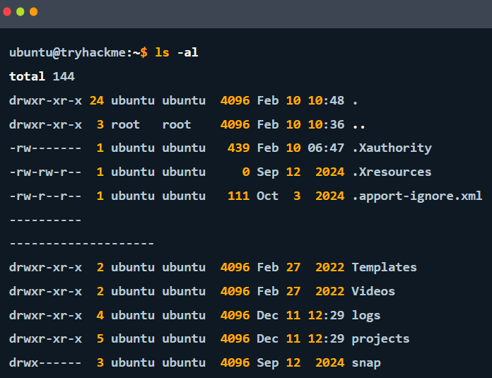
       
      <i>ls -al</i>
    </td>
  </tr>
</table>

Một số thông tin trong kết quả `ls -l`:

- Ký tự đầu tiên: `d` thường biểu thị thư mục, `-` biểu thị tệp thông thường.
- Các ký tự tiếp theo: Quyền truy cập.
- `ubuntu ubuntu`: Chủ sở hữu và nhóm sở hữu trong ví dụ.
- `4096`, `250`, `439`: Kích thước hiển thị theo byte đối với các tệp thông thường; kích thước của thư mục có ý nghĩa khác.
- Tên bắt đầu bằng dấu chấm: Thường được ẩn trong kết quả `ls` mặc định.

#### Bước 3: Di chuyển giữa các thư mục

<table align="center">
  <tr>
    <td align="center">
      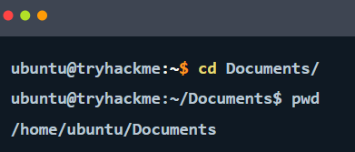
       
      <i>cd</i>
    </td>
    <td align="center">
      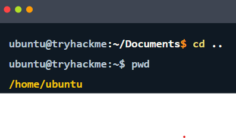
       
      <i>cd ..</i>
    </td>
  </tr>
</table>

#### Bước 4: Tìm kiếm tệp tin

<table align="center">
  <tr>
    <td align="center">
      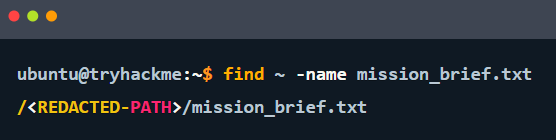
       
      <i>find</i>
    </td>
    <td align="center">
      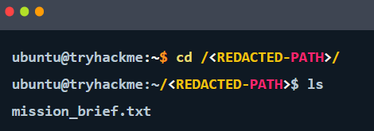
       
      <i>cd</i>
    </td>
  </tr>
</table>

Lưu ý: `find` chỉ tìm trong phạm vi được chỉ định và các thư mục con có thể truy cập được. Nếu cần tìm toàn hệ thống, có thể sử dụng điểm bắt đầu `/`, nhưng kết quả có thể nhiều và xuất hiện thông báo thiếu quyền truy cập.

#### Bước 5: Đọc nội dung tệp

  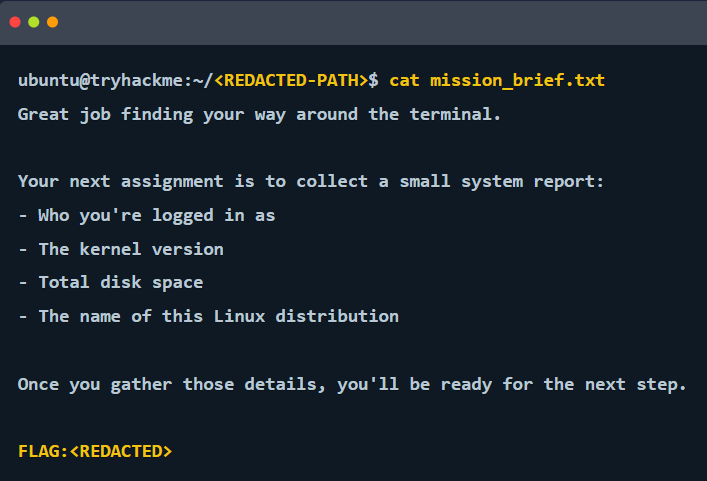
   
  <i>pwd</i>

### 2. Thu thập thông tin hệ thống

#### Bước 1: Xác định tài khoản hiện tại

  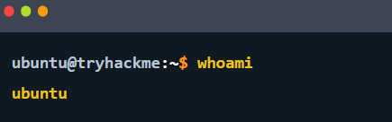
   
  <i>whoami</i>

Lệnh cho biết tên người dùng đang thực thi lệnh. Đây không nhất thiết là danh sách toàn bộ người dùng đã đăng nhập vào hệ thống.

#### Bước 2: Kiểm tra kernel và kiến trúc

  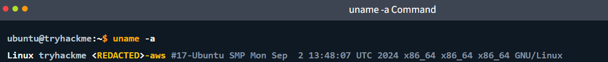
   
  <i>uname -a</i>

Các thành phần chính:

- `Linux`: Tên kernel.
- `tryhackme`: Tên máy chủ (hostname).
- `6.x.x-aws`: Ví dụ về chuỗi phiên bản kernel; giá trị thực tế phụ thuộc hệ thống.
- `x86_64`: Kiến trúc 64-bit thuộc họ x86.
- `GNU/Linux`: Thông tin nhận diện môi trường hệ điều hành trong kết quả.

#### Bước 3: Kiểm tra dung lượng lưu trữ

  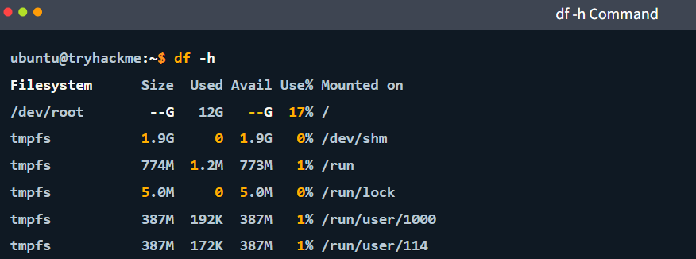
   
  <i>df -h</i>

Các cột quan trọng:

- `Filesystem`: Hệ thống tệp hoặc thiết bị lưu trữ.
- `Size`: Tổng dung lượng được báo cáo.
- `Used`: Dung lượng đã sử dụng.
- `Avail`: Dung lượng còn khả dụng.
- `Use%`: Tỷ lệ sử dụng.
- `Mounted on`: Điểm gắn kết trong cây thư mục.

Các con số trên chỉ là ví dụ minh họa. Lệnh `df -h` báo cáo dung lượng của các hệ thống tệp đã được gắn kết, không nhất thiết là tổng dung lượng vật lý của tất cả ổ đĩa.

#### Bước 4: Xác định bản phân phối Linux

  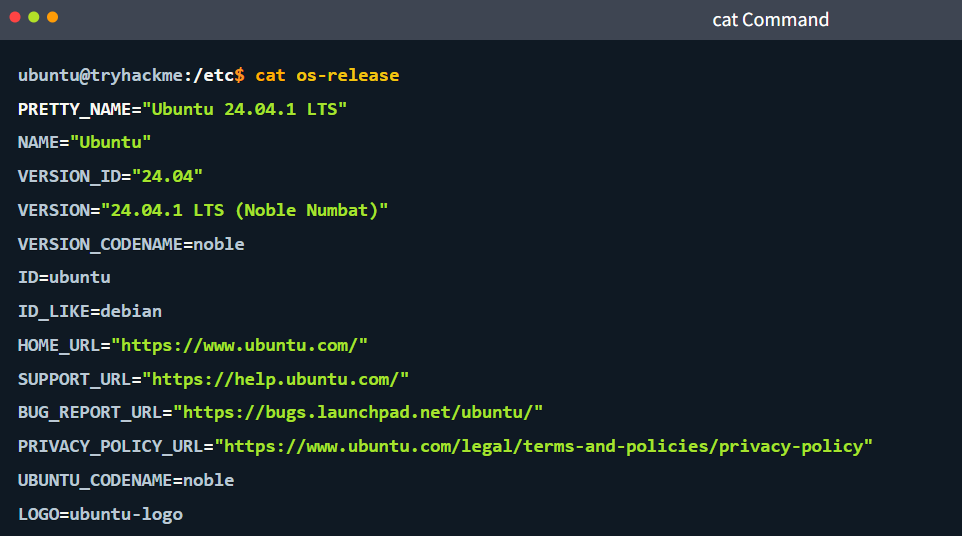
   
  <i>cat /etc/os-release</i>

Các trường thường gặp:

- `PRETTY_NAME`: Tên bản phân phối và phiên bản hiển thị đầy đủ.
- `NAME`: Tên hệ điều hành.
- `VERSION_ID`: Mã phiên bản.
- `VERSION_CODENAME`: Tên mã phiên bản.
- `ID`: Định danh bản phân phối.
- `ID_LIKE`: Các họ bản phân phối có liên quan.

Khác với `uname`, tệp `/etc/os-release` cung cấp thông tin về bản phân phối Linux thay vì tập trung vào kernel.

---

## 📚 Nguồn tham khảo

* [TryHackMe – Linux CLI Basic](https://tryhackme.com/room/linuxclibasics)

[<-- Back to Operating System Menu](../operating-system/00-MENU.md)