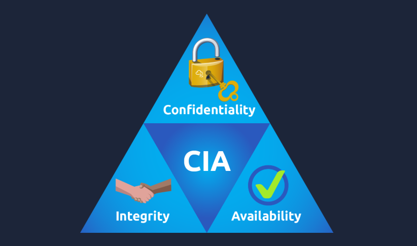

[<-- Back to Operating System Menu](../operating-system/00-MENU.md)

# 📌 Operating System Security

> Hệ điều hành quản lý phần cứng, cung cấp môi trường để ứng dụng hoạt
> động và đóng vai trò quan trọng trong việc bảo vệ dữ liệu trên máy
> tính và thiết bị di động.

------------------------------------------------------------------------

## 📖 Khái niệm

### 1. Computer Hardware - Phần cứng máy tính

**Phần cứng (hardware)** là tất cả các bộ phận và thiết bị ngoại vi của
máy tính mà con người có thể chạm vào, chẳng hạn như:

-   Màn hình (screen)
-   Bàn phím (keyboard)
-   Máy in (printer)
-   USB flash drive
-   Bo mạch chính (desktop board / motherboard)
-   Bộ xử lý trung tâm (**CPU**)
-   Bộ nhớ (**RAM**)
-   Thiết bị lưu trữ như **HDD** hoặc **SSD**

Bo mạch chính là bộ phận trung tâm kết nối các thành phần phần cứng với
nhau. Tuy nhiên, phần cứng không thể tự cung cấp môi trường để các
chương trình và ứng dụng hoạt động một cách hữu ích nếu không có hệ điều
hành quản lý chúng.

### 2. Operating System - Hệ điều hành

**Hệ điều hành (Operating System --- OS)** là lớp phần mềm nằm giữa phần
cứng và các ứng dụng. OS quản lý, điều khiển phần cứng và cho phép
chương trình truy cập phần cứng theo những quy tắc nhất định.

| Nền tảng                    | Ví dụ                                    |
| --------------------------- | ---------------------------------------- |
| Máy tính cá nhân            | Microsoft Windows, macOS                 |
| Điện thoại thông minh       | Android, iOS                             |
| Máy chủ                     | Windows Server, IBM AIX, Oracle Solaris  |
| Máy tính cá nhân và máy chủ | Linux                                    |

Các ứng dụng như trình duyệt Firefox, Safari, Chrome hoặc ứng dụng nhắn
tin Signal, WhatsApp, Telegram chạy **trên hệ điều hành**, chứ không
trực tiếp trên phần cứng.

### 3. Information Security - An toàn thông tin

Thiết bị như điện thoại và máy tính thường lưu trữ nhiều dữ liệu riêng
tư. 

Vì vậy, cần bảo vệ cả dữ liệu lẫn hệ điều hành đang quản lý dữ liệu đó.

Ba mục tiêu nền tảng của an toàn thông tin:

<p align="center">
  
  <br>
  <i>CIA</i>
</p>

-   **Confidentiality (Tính bí mật):** Chỉ người được phép mới có thể
    truy cập thông tin riêng tư.
-   **Integrity (Tính toàn vẹn):** Ngăn dữ liệu bị sửa đổi trái phép khi
    lưu trữ hoặc truyền qua mạng.
-   **Availability (Tính sẵn sàng):** Đảm bảo hệ thống và dữ liệu có thể
    sử dụng khi cần.

------------------------------------------------------------------------

## ⚙️ Cách hoạt động

### 1. Vị trí của hệ điều hành trong hệ thống

Có thể hình dung kiến trúc phần mềm và phần cứng theo thứ tự sau:

``` text
+---------------------------------------+
|        Applications / Programs        |
|  Browser, Messaging App, Email, etc.  |
+---------------------------------------+
|           Operating System            |
|       Quản lý và điều phối tài nguyên |
+---------------------------------------+
|               Hardware                |
|       CPU, RAM, HDD/SSD, Devices      |
+---------------------------------------+
```

Luồng hoạt động cơ bản:

1.  Phần cứng cung cấp tài nguyên tính toán, bộ nhớ, lưu trữ và thiết bị
    ngoại vi.
2.  Hệ điều hành quản lý phần cứng và cung cấp môi trường cho ứng dụng.
3.  Ứng dụng yêu cầu hệ điều hành truy cập các tài nguyên cần thiết.
4.  Hệ điều hành điều phối việc truy cập theo các quy tắc đã thiết lập.

### 2. Authentication and Weak Passwords - Xác thực và mật khẩu yếu

**Authentication (xác thực)** là quá trình xác minh danh tính của người
dùng khi truy cập hệ thống cục bộ hoặc từ xa.

Ba nhóm yếu tố xác thực phổ biến:

| Yếu tố                 | Ý nghĩa                        | Ví dụ                      |
| ---------------------- | ------------------------------ | -------------------------- |
| Something you know     | Thứ bạn biết                   | Mật khẩu, mã PIN           |
| Something you are      | Đặc điểm sinh trắc học của bạn | Dấu vân tay                |
| Something you have     | Thứ bạn sở hữu                 | Điện thoại nhận mã SMS     |

Mật khẩu là phương thức xác thực phổ biến, vì vậy cũng thường bị nhắm
đến. Các thói quen làm mật khẩu dễ đoán bao gồm:

-   Dùng chuỗi số đơn giản như `123456` hoặc `123456789`.
-   Dùng từ thông dụng như `password`, `iloveyou`, `monkey` hoặc
    `dragon`.
-   Dùng thông tin cá nhân như ngày sinh hoặc tên thú cưng.
-   Dùng cùng một mật khẩu cho nhiều tài khoản.
-   Dùng chuỗi ký tự theo bố cục bàn phím như `qwerty`, `qwertyuiop`
    hoặc `1q2w3e4r5t`.

Tài liệu nguồn dẫn danh sách mật khẩu phổ biến của NCSC và đưa ra 20 ví
dụ sau:

| Hạng | Mật khẩu     |
| ---- | ------------ |
| 1    | `123456`     |
| 2    | `123456789`  |
| 3    | `qwerty`     |
| 4    | `password`   |
| 5    | `111111`     |
| 6    | `12345678`   |
| 7    | `abc123`     |
| 8    | `1234567`    |
| 9    | `password1`  |
| 10   | `12345`      |
| 11   | `1234567890` |
| 12   | `123123`     |
| 13   | `000000`     |
| 14   | `iloveyou`   |
| 15   | `1234`       |
| 16   | `1q2w3e4r5t` |
| 17   | `qwertyuiop` |
| 18   | `123`        |
| 19   | `monkey`     |
| 20   | `dragon`     |

Nếu kẻ tấn công đoán được mật khẩu của tài khoản email, mạng xã hội hoặc
tài khoản trực tuyến khác, họ có thể truy cập dữ liệu riêng tư. Vì vậy,
nên dùng mật khẩu khó đoán và **mật khẩu khác nhau cho từng tài khoản**.

### 3. Weak File Permissions - Quyền truy cập tệp yếu

**File permissions (quyền truy cập tệp)** xác định ai được phép truy cập
hoặc chỉnh sửa tệp.

Nguyên tắc bảo mật quan trọng là **Principle of Least Privilege (nguyên
tắc đặc quyền tối thiểu)**: chỉ cấp quyền cần thiết cho những người cần
quyền đó để hoàn thành công việc.

Ví dụ:

-   Tài liệu công việc chỉ nên được chia sẻ với người cần sử dụng.
-   Tệp kế hoạch chuyến đi có thể chia sẻ với những người tham gia, thay
    vì công khai cho tất cả mọi người.
-   Người chỉ cần đọc tệp không nhất thiết phải có quyền chỉnh sửa tệp.

Quyền truy cập yếu có thể ảnh hưởng đến:

-   **Confidentiality:** Người không được phép có thể đọc dữ liệu.
-   **Integrity:** Người không được phép có thể sửa đổi dữ liệu.

### 4. Malicious Programs - Chương trình độc hại

Chương trình độc hại có thể ảnh hưởng đến tính bí mật, tính toàn vẹn
hoặc tính sẵn sàng, tùy thuộc vào loại chương trình.

**Trojan horse (mã độc Trojan):** - Có thể tạo điều kiện cho kẻ tấn công
truy cập hệ thống. - Kẻ tấn công có thể đọc tệp hoặc sửa đổi dữ liệu.

**Ransomware (mã độc tống tiền):** - Mã hóa các tệp của người dùng khiến
chúng không thể đọc được nếu không có khả năng giải mã phù hợp. - Kẻ tấn
công có thể yêu cầu tiền chuộc để đổi lấy khả năng khôi phục quyền truy
cập. - Đây là mối đe dọa trực tiếp đến **Availability (tính sẵn sàng)**.

------------------------------------------------------------------------

## 📝 Ghi nhớ

-   **Hardware** là các thành phần vật lý; **Operating System** quản lý
    phần cứng và tạo môi trường cho ứng dụng hoạt động.
-   Ứng dụng chạy trên hệ điều hành, không trực tiếp trên phần cứng.
-   Ba mục tiêu an toàn thông tin là **Confidentiality, Integrity,
    Availability (CIA)**.
-   Xác thực có thể dựa trên thứ bạn biết, thứ bạn là hoặc thứ bạn sở
    hữu.
-   Mật khẩu phổ biến, dễ đoán hoặc được tái sử dụng làm tăng nguy cơ
    tài khoản bị xâm nhập.
-   **Least Privilege** nghĩa là chỉ cấp quyền truy cập cần thiết.
-   Quyền tệp yếu có thể làm lộ dữ liệu hoặc cho phép sửa đổi trái phép.
-   Trojan có thể giúp kẻ tấn công truy cập và thao tác dữ liệu;
    ransomware có thể làm mất khả năng truy cập tệp.
-   Bảo vệ hệ thống cần chú ý cả xác thực, quyền truy cập và chương
    trình độc hại.

------------------------------------------------------------------------

## 🔗 Liên quan

-   Computer Hardware --- Phần cứng máy tính
-   Operating System Architecture --- Kiến trúc hệ điều hành
-   Authentication --- Xác thực
-   Password Security --- Bảo mật mật khẩu
-   File Permissions and Access Control --- Quyền tệp và kiểm soát truy
    cập
-   Principle of Least Privilege --- Nguyên tắc đặc quyền tối thiểu
-   Malware --- Phần mềm độc hại
-   Trojan Horse --- Mã độc Trojan
-   Ransomware --- Mã độc tống tiền
-   CIA Triad --- Confidentiality, Integrity, Availability

------------------------------------------------------------------------

## 📚 Nguồn tham khảo

* [TryHackMe – Operating System Security](https://tryhackme.com/room/operatingsystemsecurity)

[<-- Back to Operating System Menu](../operating-system/00-MENU.md)