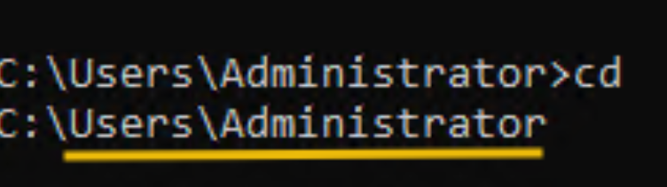
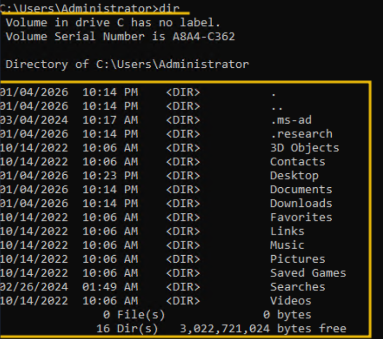
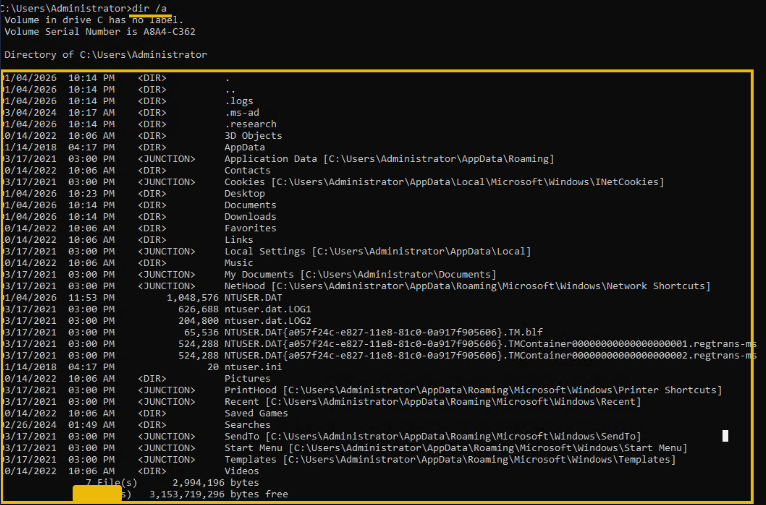
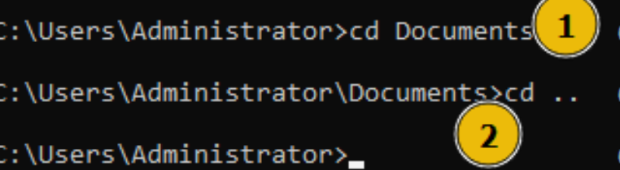
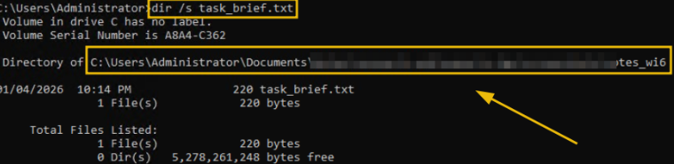
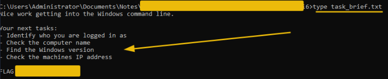
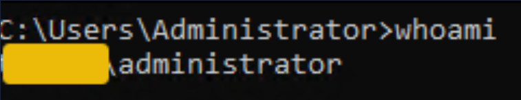
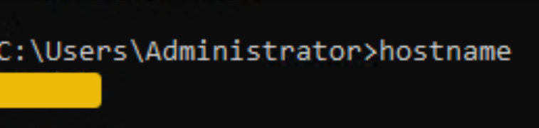
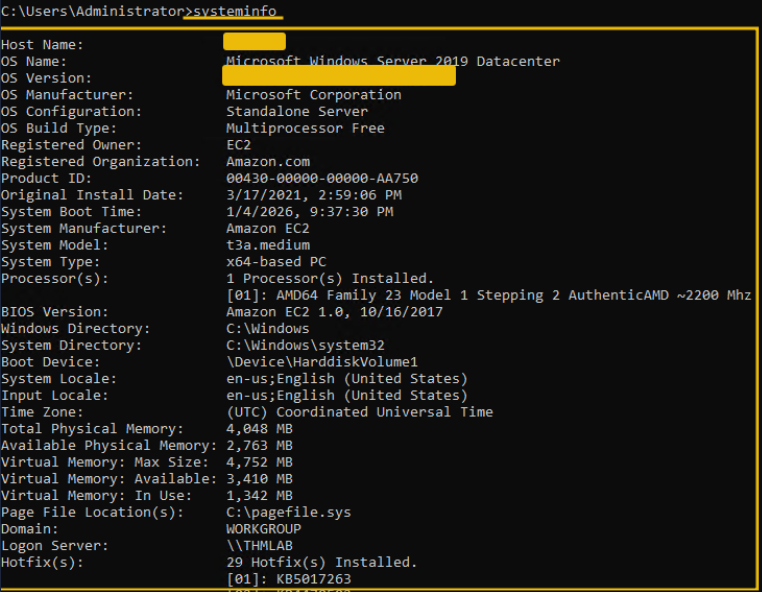
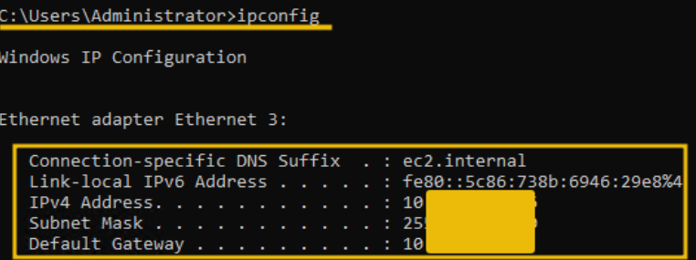

[<-- Back to Operating System Menu](../operating-system/00-MENU.md)

# 📌 Windows CLI Basic – Giao diện dòng lệnh Window cơ bản 

> Sử dụng Command Prompt để điều hướng hệ thống tệp, tìm kiếm tệp và thu thập thông tin cơ bản về hệ điều hành Windows.

---

## 📖 Khái niệm

**Terminal** là giao diện dạng văn bản cho phép người dùng tương tác với hệ điều hành bằng cách nhập lệnh thay vì thao tác qua cửa sổ và thư mục bằng chuột.

Trên Windows, **Command Prompt (CMD)** là một môi trường dòng lệnh cho phép thực hiện các thao tác quản trị và kiểm tra hệ thống.

Terminal được sử dụng trong lĩnh vực công nghệ thông tin và an ninh mạng vì:

- Thực hiện nhiều thao tác nhanh hơn so với giao diện đồ họa.
- Cho phép kiểm soát hệ thống thông qua các câu lệnh.
- Nhiều công cụ bảo mật chỉ có thể sử dụng hoặc hoạt động hiệu quả thông qua dòng lệnh.

Trong bài học này, các lệnh được chia thành hai nhóm chính:

1. **Quản lý và tìm kiếm tệp:** Di chuyển giữa các thư mục, liệt kê nội dung, tìm kiếm và đọc tệp.
2. **Thu thập thông tin hệ thống:** Kiểm tra tài khoản đang đăng nhập, tên máy tính, phiên bản Windows và cấu hình mạng.

---

## ⚙️ Cách hoạt động

### 1. Điều hướng và tìm kiếm tệp

#### Xác định thư mục hiện tại

  
   
  <i>Lệnh hiển thị đường dẫn đầy đủ của thư mục hiện tại</i>

#### Liệt kê tệp và thư mục

  
   
  <i>Lệnh hiển thị danh sách các tệp và thư mục trong vị trí hiện tại</i>

  
   
  <i>Lệnh hiển thị cả các mục được đánh dấu ẩn</i>

Lưu ý: Tệp hoặc thư mục ẩn không có nghĩa là bí mật; Windows chỉ không hiển thị chúng trong danh sách thông thường.

#### Di chuyển giữa các thư mục

  
   
  <i>Lệnh chuyển đến thư mục `Documents` nằm trong thư mục hiện tại</i>

#### Tìm kiếm tệp trong các thư mục con

  
   
  <i>Lệnh trả về cho biết vị trí của tệp nếu tìm thấy</i>

Trong đó:
- `dir`: Liệt kê tệp và thư mục.
- `/s`: Tìm kiếm trong tất cả thư mục con bắt đầu từ vị trí hiện tại.
- `task_brief.txt`: Tên tệp cần tìm.

#### Di chuyển đến thư mục chứa tệp

Sau khi xác định được đường dẫn, sử dụng:

  
   
  <i>Lệnh trả về cho biết vị trí của tệp nếu tìm thấy</i>

#### Đọc nội dung tệp

  
   
  <i>Lệnh trả về Nội dung tệp văn bản sẽ được hiển thị trực tiếp trên Command Prompt</i>

---

### 2. Thu thập thông tin hệ thống

#### Kiểm tra tài khoản đang đăng nhập

  
   
  <i>Lệnh hiển thị tên tài khoản người dùng hiện đang đăng nhập</i>

Thông tin này giúp xác định danh tính tài khoản đang sử dụng và hỗ trợ đánh giá quyền truy cập trên hệ thống.

#### Kiểm tra tên máy tính

  
   
  <i>Hiển thị tên của máy tính Windows đang sử dụng</i>

Tên máy tính giúp nhận diện hệ thống, đặc biệt trong môi trường doanh nghiệp có nhiều máy tính kết nối mạng.

#### Kiểm tra thông tin hệ điều hành

  
   
  <i>Hiển thị nhiều thông tin chi tiết về hệ thống</i>

Trong bài học này, cần chú ý ba trường:

- `OS Name`: Tên hệ điều hành.
- `OS Version`: Phiên bản hệ điều hành.
- `System Type`: Loại hệ thống, chẳng hạn hệ thống 32-bit hoặc 64-bit.

#### Kiểm tra cấu hình mạng

  
   
  <i>Hiển thị thông tin cấu hình mạng của máy tính</i>

Cần chú ý hai thông tin:

- `IPv4 Address`: Địa chỉ IPv4 của máy tính.
- `Default Gateway`: Địa chỉ cổng mặc định được sử dụng để giao tiếp với các mạng khác.

---

## 📝 Ghi nhớ

- `cd`: Kiểm tra thư mục hiện tại hoặc thay đổi thư mục.
- `dir`: Liệt kê tệp và thư mục.
- `dir /a`: Hiển thị cả các mục ẩn.
- `dir /s <ten_tệp>`: Tìm kiếm tệp trong các thư mục con.
- `type <ten_tệp>`: Đọc nội dung tệp văn bản.
- `whoami`: Xác định tài khoản đang đăng nhập.
- `hostname`: Xem tên máy tính.
- `systeminfo`: Xem thông tin hệ điều hành và hệ thống.
- `ipconfig`: Xem cấu hình mạng.
- Trong quá trình kiểm tra hệ thống, cần xác định tài khoản, thiết bị, hệ điều hành và cấu hình mạng trước khi tiến hành các bước phân tích tiếp theo.

---

## 🔗 Liên quan

- Windows Command Prompt (CMD)
- Windows File System
- Windows User Accounts
- Windows System Information
- IP Address
- Default Gateway
- Network Troubleshooting

---

## 📚 Nguồn tham khảo

* [TryHackMe – Windows CLI Basic](https://tryhackme.com/room/windowsclibasics)

[<-- Back to Operating System Menu](../operating-system/00-MENU.md)