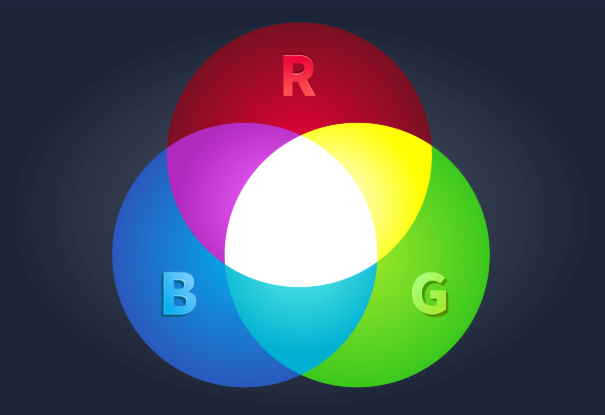

[<-- Back to Software Menu](../software/00-MENU.md)

# 📌 Data Representation

> Khám phá cách máy tính biểu diễn màu sắc, lưu trữ dữ liệu và thực hiện các phép tính thông qua hai trạng thái nhị phân 0 và 1. Tìm hiểu Binary, Decimal, Hexadecimal và Octal để hiểu cách dữ liệu được biểu diễn bên trong máy tính.

---

## 📖 Khái niệm

### 1. RGB Color Model — Mô hình màu RGB

RGB là mô hình màu kết hợp ba nguồn ánh sáng cơ bản:

- **Red (R):** Đỏ
- **Green (G):** Xanh lá
- **Blue (B):** Xanh dương

Có thể hình dung RGB giống như ba nút điều chỉnh độ sáng. Mỗi nút điều khiển cường độ của một màu.

Bằng cách thay đổi cường độ của ba màu này, máy tính có thể tạo ra hàng triệu màu sắc khác nhau.

<p align="center">
  
  <br>
  <i>RGB</i>
</p>

### 2. Bit và Byte

**Bit (Binary Digit):**
- Là đơn vị dữ liệu cơ bản nhất trong máy tính.
- Chỉ có thể nhận một trong hai giá trị: `0` hoặc `1`.
- Tương ứng với hai trạng thái: OFF hoặc ON.

**Byte:**
- Là nhóm gồm 8 bit.
- Có thể biểu diễn \(2^8 = 256\) giá trị khác nhau.
- Trong một số tài liệu, byte 8 bit còn được gọi là Octet.

### 3. Binary — Hệ nhị phân

Hệ nhị phân sử dụng hai chữ số:

- `0`
- `1`

Đây là hệ thống biểu diễn dữ liệu cơ bản của máy tính.

### 4. Hexadecimal — Hệ thập lục phân

Hexadecimal (Hex) là hệ đếm cơ số 16, sử dụng 16 ký hiệu:

```text
0 1 2 3 4 5 6 7 8 9 A B C D E F
```

Trong đó:

- `0–9` tương ứng với giá trị thập phân từ 0 đến 9.
- `A–F` tương ứng với giá trị thập phân từ 10 đến 15.

Mỗi chữ số Hexadecimal đại diện cho 4 bit Binary.

### 5. Octal — Hệ bát phân

Octal là hệ đếm cơ số 8, sử dụng các chữ số:

```text
0 1 2 3 4 5 6 7
```

Mỗi chữ số Octal tương ứng với 3 bit Binary.

---

## ⚙️ Cách hoạt động

### 1. Biểu diễn 8 màu RGB đầu tiên

Giả sử mỗi ánh sáng RGB chỉ có hai trạng thái:

- ON: Bật.
- OFF: Tắt.

Mỗi màu có 2 trạng thái, vì vậy tổng số màu có thể tạo ra là:

= 2^3 = 8

Máy tính sử dụng 3 bit để biểu diễn trạng thái của ba màu RGB.

| Binary | Ý nghĩa | Color |
|---|---|---|
| `000` | Tắt cả ba màu | Black |
| `001` | Chỉ bật Blue | Blue |
| `010` | Chỉ bật Green | Green |
| `100` | Chỉ bật Red | Red |
| `011` | Bật Green và Blue | Cyan |
| `101` | Bật Red và Blue | Magenta |
| `110` | Bật Red và Green | Yellow |
| `111` | Bật cả ba màu | White |

### 2. Mở rộng từ 8 màu lên hơn 16 triệu màu

Thay vì chỉ có hai trạng thái ON/OFF, mỗi kênh RGB có thể có 256 mức cường độ khác nhau.

Số lượng màu có thể biểu diễn:

= 256^3 = 16,777,216

Nên mỗi kênh màu cần 8 bit, tương đương 1 byte.

| Color Channel | Bit | Number of Levels |
|---|---:|---:|
| Red | 8 bits | 256 |
| Green | 8 bits | 256 |
| Blue | 8 bits | 256 |
| **Total** | **24 bits** | **16,777,216 colors** |

Như vậy:

- 1 kênh màu = 8 bit = 1 byte.
- 3 kênh màu = 24 bit = 3 byte.

Ví dụ một màu được biểu diễn bằng Binary:

```text
10100011 11101010 00101010
```

Trong đó:

```text
Red:   10100011
Green: 11101010
Blue:  00101010
```

### 3. Hexadecimal Color Representation

Viết 24 bit Binary khá dài và khó đọc.

Hexadecimal giúp rút gọn bằng cách chuyển mỗi nhóm 4 bit thành một chữ số Hex.

Ví dụ:

```text
Binary: 10100011 11101010 00101010
Hex:    A3       EA       2A
```

Kết quả:

```text
A3EA2A
```

Cấu trúc mã màu RGB 24-bit:

```text
#RRGGBB
```

Trong đó:

- `RR`: Cường độ Red.
- `GG`: Cường độ Green.
- `BB`: Cường độ Blue.

Mỗi kênh màu được biểu diễn bằng 2 chữ số Hexadecimal.

Ví dụ:

```text
#A3EA2A
```

| Channel | Hex Value | Meaning |
|---|---|---|
| Red | A3 | Cường độ màu đỏ |
| Green | EA | Cường độ màu xanh lá |
| Blue | 2A | Cường độ màu xanh dương |

### 4. Bảng chuyển đổi Hexadecimal sang Binary

| Hex | Binary |
|---|---|
| 0 | `0000` |
| 1 | `0001` |
| 2 | `0010` |
| 3 | `0011` |
| 4 | `0100` |
| 5 | `0101` |
| 6 | `0110` |
| 7 | `0111` |
| 8 | `1000` |
| 9 | `1001` |
| A | `1010` |
| B | `1011` |
| C | `1100` |
| D | `1101` |
| E | `1110` |
| F | `1111` |

### 5. Octal — Hệ bát phân

Octal sử dụng cơ số 8 và các chữ số từ 0 đến 7.

Nên mỗi chữ số Octal tương ứng với 3 bit Binary.

| Decimal | Octal | Binary |
|---:|---:|---|
| 0 | 0 | `000` |
| 1 | 1 | `001` |
| 2 | 2 | `010` |
| 3 | 3 | `011` |
| 4 | 4 | `100` |
| 5 | 5 | `101` |
| 6 | 6 | `110` |
| 7 | 7 | `111` |

---

## 📝 Ghi nhớ

### Bit và Byte

- 1 bit có thể biểu diễn 2 trạng thái: `0` và `1`.
- 1 byte = 8 bits.
- 8 bits có thể biểu diễn 256 giá trị khác nhau.

### RGB Color

- RGB gồm 3 kênh: Red, Green, Blue.
- Mỗi kênh sử dụng 8 bit.
- Tổng cộng 24 bit = 3 bytes.
- RGB 24-bit biểu diễn được 16,777,216 màu.

### Hexadecimal

- Hexadecimal sử dụng cơ số 16.
- Các ký hiệu gồm `0–9` và `A–F`.
- 1 Hex digit = 4 bits.
- 1 Byte = 2 Hex digits.
- Mã màu RGB thường có cấu trúc `#RRGGBB`.

### Octal

- Octal sử dụng cơ số 8.
- Các chữ số từ `0–7`.
- 1 Octal digit = 3 bits.

### Công thức quan trọng

| Nội dung | Công thức |
|---|---|
| Số trạng thái của n bit | \(2^n\) |
| Số màu RGB 24-bit | \(256^3 = 2^{24}\) |
| Số bit trong một byte | 8 |
| Số bit trong một Hex digit | 4 |
| Số bit trong một Octal digit | 3 |
| Giá trị vị trí hệ cơ số b | \(b^0, b^1, b^2, ...\) |

### Bảng so sánh các hệ đếm

| Number System | Base | Digits | Bit Grouping |
|---|---:|---|---:|
| Binary | 2 | 0–1 | 1 bit |
| Octal | 8 | 0–7 | 3 bits |
| Decimal | 10 | 0–9 | Không có nhóm bit cố định |
| Hexadecimal | 16 | 0–9, A–F | 4 bits |

---

## 🔗 Liên quan

- Binary Number System — Hệ nhị phân
- Decimal Number System — Hệ thập phân
- Hexadecimal Number System — Hệ thập lục phân
- Octal Number System — Hệ bát phân
- Bit and Byte — Đơn vị dữ liệu
- RGB Color Model — Mô hình màu RGB
- Data Representation — Biểu diễn dữ liệu
- Number Base Conversion — Chuyển đổi cơ số
- Computer Fundamentals — Kiến thức máy tính cơ bản

---

## 📚 Nguồn tham khảo

* [TryHackMe – Data Representation](https://tryhackme.com/room/datarepresentation)

[<-- Back to Software Menu](../software/00-MENU.md)