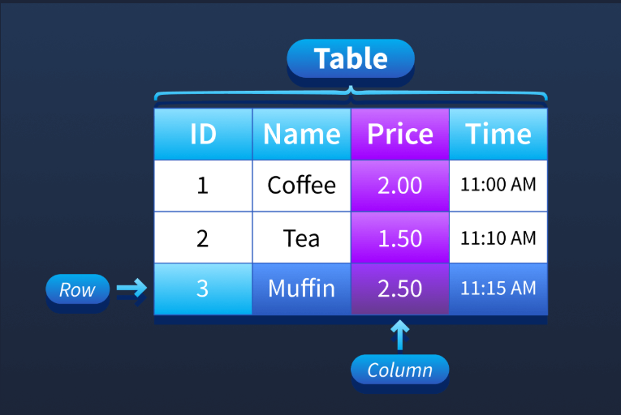

[<-- Back to Software Menu](../software/00-MENU.md)

# 📌 Database SQL Basics

> Tìm hiểu khái niệm Database, cách dữ liệu được tổ chức thành Tables, Rows và Columns, cũng như cách sử dụng SQL để truy vấn thông tin.

---

## 📖 Khái niệm

### 1. Database

**Database (Cơ sở dữ liệu)** là nơi máy tính lưu trữ thông tin theo một cách có tổ chức, giúp việc tìm kiếm, sắp xếp, đếm và truy xuất dữ liệu trở nên nhanh chóng và hiệu quả.

Có thể hình dung Database như một cuốn sổ ghi chép kỹ thuật số không giới hạn số trang.

So với việc lưu trữ bằng sổ giấy:

| Paper Notebook | Database |
|---|---|
| Phải đọc và tìm kiếm thủ công | Tìm kiếm tự động |
| Đếm dữ liệu bằng tay | Có thể đếm bằng truy vấn |
| Khó sắp xếp dữ liệu lớn | Sắp xếp nhanh chóng |
| Khó quản lý khi dữ liệu tăng | Quản lý hàng nghìn hoặc nhiều bản ghi |

### 2. Tables, Rows & Columns

Trong Database, thông tin thường được lưu trữ dưới dạng **Tables (bảng)**, có cấu trúc tương tự một bảng tính.

Một Table được tổ chức thành Rows và Columns.

| Thành phần | Ý nghĩa |
|---|---|
| Table | Bảng chứa tập hợp dữ liệu có cấu trúc |
| Column | Cột, mô tả một loại thông tin |
| Row | Hàng, chứa một bản ghi hoàn chỉnh |
| Record | Bản ghi, tập hợp thông tin về một đối tượng hoặc sự kiện |

### 3. Columns (Cột)

Column xác định loại thông tin được lưu trữ trong bảng.

Ví dụ, bảng đơn hàng của quán cà phê có thể gồm:

- `order_number`: Mã đơn hàng
- `drink`: Tên đồ uống
- `price`: Giá tiền
- `time`: Thời gian đặt hàng

Mỗi column lưu một loại dữ liệu cụ thể.

### 4. Rows (Hàng)

Row đại diện cho **một bản ghi hoàn chỉnh (Complete Record)**.

Trong ví dụ quán cà phê, mỗi row tương ứng với một đơn hàng, chứa tất cả thông tin của đơn hàng đó.

Nếu quán bán 10 đồ uống trong một ngày, bảng có 10 rows. Khi có thêm một đơn hàng mới, bảng sẽ có thêm một row.

Nếu xóa một đơn hàng, chỉ row tương ứng bị xóa, những row còn lại vẫn giữ nguyên.

### 5. Café Database Example

Giả sử quán cà phê lưu đơn hàng trong bảng `orders`:

| order_number | drink | price | time |
|---:|---|---:|---|
| 1 | Coffee | $2.50 | 08:15 |
| 2 | Latte | $3.50 | 08:20 |
| 3 | Tea | $2.00 | 08:35 |
| 4 | Cappuccino | $3.00 | 09:10 |
| 5 | Coffee | $2.50 | 09:25 |

Trong bảng này:

- **Table:** `orders`
- **Columns:** `order_number`, `drink`, `price`, `time`
- **Rows:** 5
- **Records:** 5 đơn hàng

Mỗi row chứa đầy đủ thông tin của một đơn hàng.

---

## ⚙️ Cách hoạt động

### 1. Cách dữ liệu được tổ chức

<p align="center">
  
  <br>
  <i>Table</i>
</p>

- Column đi theo chiều dọc và chứa cùng một loại dữ liệu.
- Row đi theo chiều ngang và chứa thông tin của một bản ghi.

### 2. Thêm và xóa dữ liệu

**Thêm đơn hàng:**

Khi khách hàng đặt thêm một đồ uống, Database thêm một row mới.

```text
Before: 5 records
        ↓ Add a new order
After:  6 records
```

**Xóa đơn hàng:**

Khi xóa một đơn hàng, chỉ record đó bị loại bỏ.

```text
Before: 5 records
        ↓ Delete order #3
After:  4 records
```

Các bản ghi khác không bị ảnh hưởng.

### 3. Asking Questions With SQL

**SQL (Structured Query Language)** là ngôn ngữ được sử dụng để tương tác với Database, cho phép truy vấn và thao tác dữ liệu.

Thay vì đọc từng row thủ công, chúng ta có thể yêu cầu Database tìm kiếm, đếm hoặc sắp xếp dữ liệu.

Ví dụ, truy vấn tất cả dữ liệu trong bảng `orders`:

```sql
SELECT * FROM orders;
```

Trong đó:

- `SELECT`: Chọn dữ liệu muốn truy xuất.
- `*`: Lấy tất cả columns.
- `FROM orders`: Lấy dữ liệu từ bảng `orders`.

SQL giúp máy tính xử lý dữ liệu thay vì người dùng phải kiểm tra từng record.

---

## 📝 Ghi nhớ

- Database là nơi lưu trữ dữ liệu có tổ chức.
- Database chứa các Tables.
- Table được cấu trúc bởi Rows và Columns.
- Column đại diện cho một loại thông tin.
- Row đại diện cho một bản ghi hoàn chỉnh.
- Mỗi đơn hàng trong ví dụ café tương ứng với một Row.
- Thêm một đơn hàng sẽ thêm một Row.
- Xóa một đơn hàng sẽ loại bỏ Row tương ứng.
- SQL là ngôn ngữ dùng để truy vấn và tương tác với Database.

---

## 🔗 Liên quan

- Database Fundamentals
- SQL (Structured Query Language)
- Database Tables
- Rows & Columns
- Data Retrieval
- SELECT Statements

---

## 📚 Nguồn tham khảo

* [TryHackMe – Database SQL Basics](https://tryhackme.com/room/databasesqlbasics)

[<-- Back to Software Menu](../software/00-MENU.md)